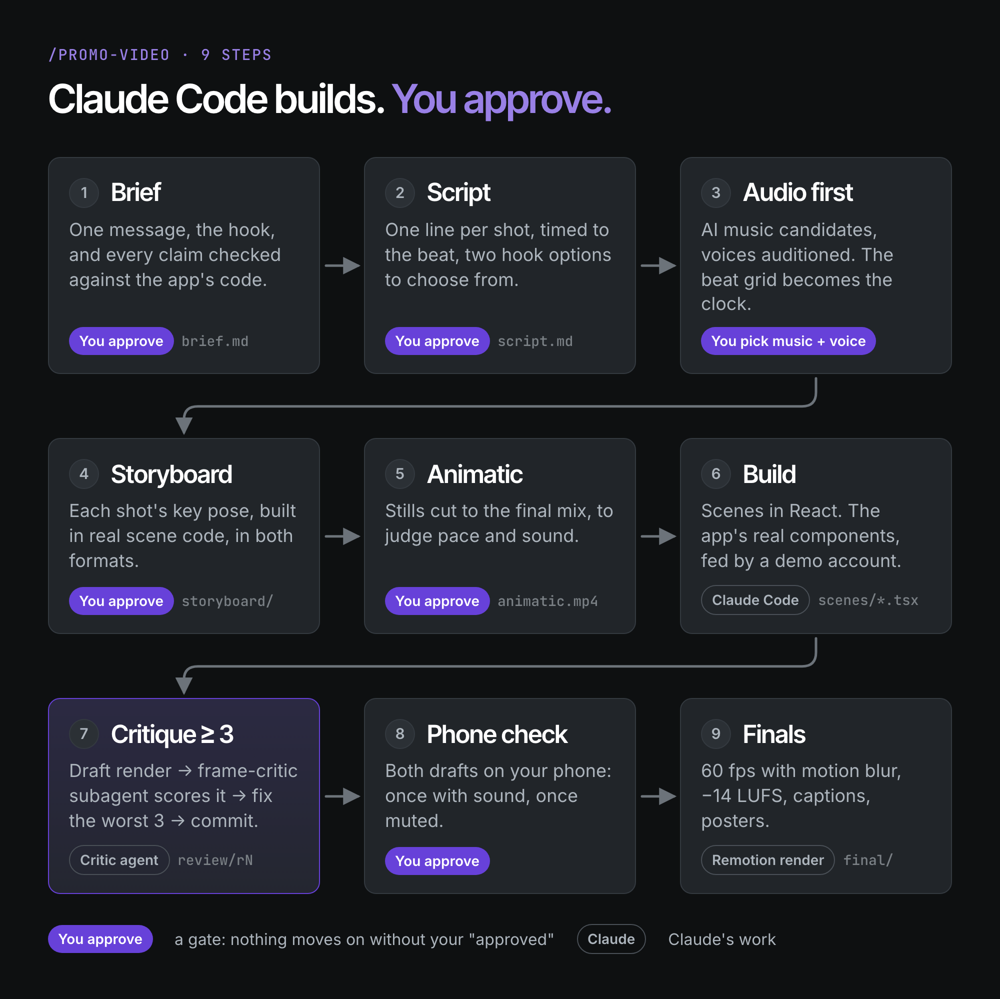
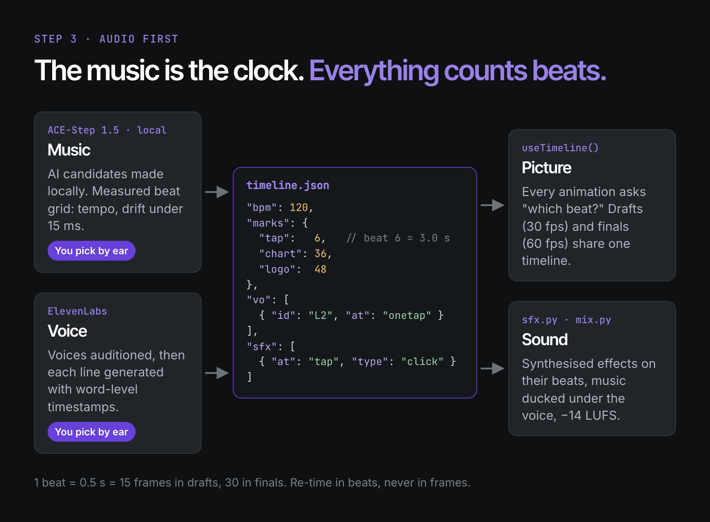
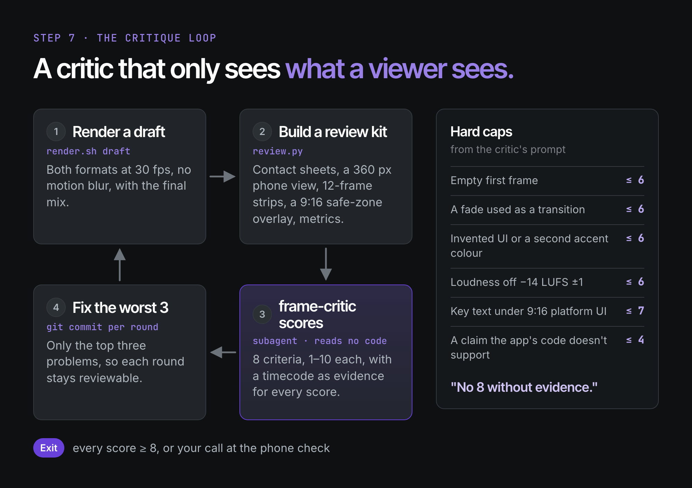

# claude-video-studio

A Claude Code skill and Remotion project for making **product promo videos in code**. You describe the product
once. Claude then works through a 9-step pipeline: brief, script, music and voice, storyboard, animatic, build,
critique and finals. It stops at every step that needs taste and waits for your "approved". A separate
critic subagent reviews each draft from the rendered frames, never from the code.

**Made with this kit:** [Habitmon](https://habitmon.in)'s 30-second launch film.



## What you get
- **A gated pipeline** (`/promo-video <slug>`). Every step writes a file (`brief.md`, `script.md`, `timeline.json`,
  storyboard stills, an animatic, drafts) and stops for your approval where taste matters. It resumes from its log.
- **Audio first.** The music's beat grid is the clock: every cut, animation, voice line and sound effect is placed
  in beats, so 30 fps drafts and 60 fps finals share one timeline.
- **Your real UI, not mockups.** Claude ports your app's components into the video with demo data, and checks
  every on-screen claim against your code.
- **Two formats from one timeline.** 9:16 (Reels, Shorts, TikTok) and 16:9 (YouTube, your site), each laid out on
  its own, never cropped.
- **A critic that can't be charmed.** `frame-critic` scores 8 criteria from contact sheets, a 360 px phone view,
  frame strips around every cut and a safe-zone overlay, with hard caps for known mistakes.
- **Finished files.** 60 fps with motion blur, mastered to −14 LUFS, captions (`.srt`) and posters.





## Requirements
- [Claude Code](https://claude.com/claude-code)
- Node 20+, ffmpeg, Python 3.12
- An [ElevenLabs](https://elevenlabs.io) API key for the voiceover (check your plan's licence terms; see Licences below)
- Optional: [ACE-Step 1.5](https://github.com/ACE-Step/ACE-Step-1.5) for AI music generated on your own machine
  (about 9 GB of checkpoints). Without it, `tools/music_synth.py` writes a score in code, or you bring a track.
- Optional: `yt-dlp` for studying reference videos (see `tools/refs.sh`)
- Your app running locally with a demo account, if you want screen captures

## Quick start
```bash
git clone https://github.com/rishabhsxn/claude-video-studio.git my-videos && cd my-videos
npm install
npx playwright install chromium
python3.12 -m venv .venv && .venv/bin/pip install -r requirements.txt
cp .env.example .env        # then type your ElevenLabs key into .env yourself
claude                      # open Claude Code in this folder
```
Inside Claude Code:
```
/promo-video setup          # reads your app's code, asks a few questions, fills the brand files
/promo-video launch-30s     # makes a video called "launch-30s", gate by gate
```

## Make it yours
`/promo-video setup` fills these. You can also edit them by hand; `npm run placeholders` lists anything still empty.

| File | What it holds |
|---|---|
| `studio.config.json` | App name, short slug (for file names), URL, path to your app's code (read-only), logo file |
| `brand/brand.md` | What the product is, audience, promise, CTA, and the **claims table**: each claim and the file in your code that proves it |
| `brand/frame.md` + `src/theme.ts` | Colours, fonts, radii, motion personality, end card |
| `brand/sound.md` | Voice (provider, voice ID, settings, licence), music style and tempo, sound-effect palette, mix targets |
| `public/brand/logo.svg` | Your single-colour logo (the placeholder is four squares) |
| `src/kit/app/` | Your app's components, ported for video (see the README there) |

The house rules in `CLAUDE.md` (render contract, banned looks, safe zones, gates) are sensible defaults. Change
them if your brand wants something else.

## Layout
| Path | What |
|---|---|
| `.claude/skills/promo-video/` | The skill: `SKILL.md` (the gated pipeline), `reference/` (motion and audio know-how), `templates/` |
| `.claude/agents/frame-critic.md` | The critic: scorecard, hard caps, failure modes |
| `CLAUDE.md` | House rules every session loads |
| `src/motion/` | Beat timeline hooks, springs, text reveals, camera, counters, formats and safe zones |
| `src/kit/` | Stage and Shot, liquid backdrop, grain, cursor, logo lockup, your ported UI |
| `tools/` | Timeline sync, render, review kit, storyboard, capture, music, beats, SFX, voice, mix, finish |
| `videos/<slug>/` | One folder per video: brief, script, shotlist, `timeline.json`, scenes, review rounds, finals |
| `videos/smoke/` | A 5-second setup test: headline → logo → your URL |

## Commands
```bash
npm run dev                                    # Remotion Studio (plays the mix once it exists)
npm run placeholders                           # what's still unfilled
node tools/sync.mjs <slug>                     # resolve timeline.json (beats) → timeline.resolved.json
tools/render.sh <slug> draft|final [9x16|16x9] [--frames=a-b]
.venv/bin/python tools/music_synth.py <slug>   # or tools/music_ace.py (see reference/audio.md)
.venv/bin/python tools/beats.py <slug> --file <track> --bpm <bpm>
.venv/bin/python tools/vo.py <slug> --list-voices | --audition A,B,C | --voice <id>
.venv/bin/python tools/sfx.py <slug> && .venv/bin/python tools/mix.py <slug>
node tools/storyboard.mjs <slug> [--animatic]
.venv/bin/python tools/review.py <slug> <round> [--mode final]
.venv/bin/python tools/finish.py <slug> [--mode draft]
```
Try the pipeline end to end before your first real video: `node tools/sync.mjs smoke && tools/render.sh smoke draft`.

## Good to know
- **Claude can't hear or watch in real time.** It measures tempo, grid fit, loudness and clipping. You pick the
  music and the voice by ear, and you watch the drafts on your phone. That's why those steps are gates.
- **Plan on hours, not minutes.** A polished 30-second film took about 14 hours and 7 critique rounds. Final renders
  take about 18–19 minutes per format on an M1 Pro.
- **Decide when polishing stops before round 1** ("3 rounds, or every score ≥ 8"). The critic will always find
  something.

## Licences
- **This kit:** MIT (see `LICENSE`).
- **Remotion** has its own licence: free for individuals and companies of up to 3 people; larger companies need a
  [company licence](https://www.remotion.dev/license).
- **ElevenLabs:** the free plan is non-commercial, and ElevenLabs asks for attribution (`elevenlabs.io`) when
  free-plan audio is published. Paid plans include a commercial licence. Check the current terms for your use.
- **ACE-Step 1.5:** MIT. Its authors ask users to disclose AI involvement in generated music.
- **Reference videos** (`tools/refs.sh`): local study only. They belong to their creators: learn the grammar,
  never copy the content, and never commit or publish them (`refs/` is git-ignored).
- **Fonts:** the defaults (Inter Tight, Roboto) load from Google Fonts under open licences. Only add a local font
  if its licence allows it.
